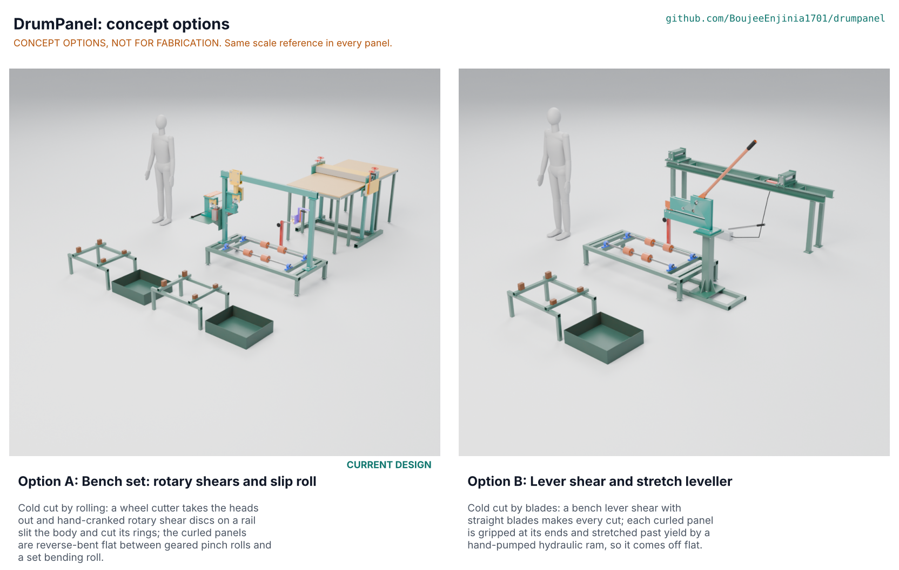

# DrumPanel concept options

Result: option A, the current bench set of rotary shears and a slip roll, scores 186 of 230 against 165 for option B, a lever shear and stretch leveller, 11 % apart, so option A is recommended and the choice is **proposed, awaiting Amish** (DMP-DEC-001, DMP-DDR-005). Option B is cheaper and simpler to build, but it is slower, harder to guard, loses about 86 mm from each panel to its grips and cuts a slot into each head disc. Both options are modelled to detail level D3 in `cad/src/model.py` (Amish, 2026-10-24: "Detail every option"). Method: STANDARDS section 21.

*Figure 1. Options A and B rendered from the D3 models at one scale, with a 1.75 m person (`python .kit/options.py`; the picture is rendered by the portfolio coordinator).*

## The options

Both options share the first two steps, which are where the safety case lives: accept only drums labelled for non-volatile oils, then purge with water on the sloping drain stand and pass a pumped LEL check below 5 % at both bungs (DMP-STM-001 S4). They differ in how the drum is cut and how the curled body is made flat.

### Option A: bench set with rotary shears and a slip roll (the current design)

**Principle.** Cold cut by rolling: a knurled wheel drives a hardened cutter wheel round inside each chime to take the heads out whole; a lever punch notches the chimes and hoops on the slit line; a hand-cranked rotary shear head, two D2 discs on an overhead rail, slits the body, then swivels and, with a ring head bolted on, cuts the chime rings and hoop strips two at a time as the drum turns on its rollers. The three curled panels are reverse-bent flat between geared pinch rolls and a bending roll set by a dial.

It is the design taken to TRL 3 on 2026-10-03 (DMP-DDR-001 to DMP-DDR-004) and is not changed by this document. Risks: throughput below PR-007 (about 2.20 against 2.5 drums an hour); the chime notch force and the disc traction rest on screening coefficients (DMP-STM-001 S7, S13); the flatness setting changes with the steel from drum to drum, so it needs a trial pass for each batch and a straightedge check of the first panel of every drum (STEM fix F1). Needs from a partner: real drums for the trial pass and the scrap-chime punch test; apprentices to time the work.

### Option B: lever shear and stretch leveller

**Principle.** Cold cut by blades: a deep-throat lever shear with straight D2 blades stands at the end of the same roller cradle; its lower jaw enters the open drum along the axis and a 1,050 mm lever drives the upper blade through a crank and link, about 22 to 1 at the cut. The heads are cut out round the inside of the chime, starting from the 2 in bung hole; then the chime rings, the hoop strips and the slit are cut stroke by stroke as the drum is rolled or slid on the cradle. Each curled panel is then gripped 60 mm at each end in self-tightening wedge grips on a channel bed and stretched about 2 % past yield by a 15 t hand-pumped hydraulic cylinder, which wipes out the curl (stretcher levelling).

Risks: the lever shear's blades and link are open at the cut and hard to guard to ISO 13857; about 380 short strokes a drum make it repetitive; the wedge grips must not let go under 93 kN (a gripped panel that slips releases stored energy); each head disc keeps the slot from the bung; each panel comes out about 1,714 mm long. Needs from a partner: the same, plus a hydraulic supplier for the cylinder and pump.

## First-order numbers

Table 1. Options compared. Option A from DMP-CAL-001 v0.3, the priced BOM and `cad/fidelity.json`; option B first-order from DMP-STM-001 rows B1 to B8 and its D3 model.

| Quantity | Option A | Option B |
| --- | --- | --- |
| Estimated parts cost (USD) | 3,566 (priced BOM; value-engineering target 3,000) | About 2,800 (estimate: the shared purge, check and safety lines of the BOM, USD 1,022, the cradle lines, USD 222, about USD 840 for the shear and stretch bed in steel and tool steel, about USD 600 for a 15 t cylinder and hand pump, and the finishing tools; a branded 10 t cylinder and pump set lists at USD 2,216, so the hydraulics could cost more) |
| Mass of the D3 model (kg) | 403 (818 parts, two drain stands) | 347 (439 parts) |
| Output | About 2.20 drums an hour for two people [H5] | About 1.65 drums an hour (B8, estimate) |
| Hardest hand force | 136 N, two ring cuts at 1.5 mm (S6) | 122 N per shear stroke, about 380 strokes a drum (B1); 88 N on the pump handle (B4) |
| Panels per drum | Three, 233 to 234 x 1,800 mm; two whole head discs 552 mm | Three, about 233 x 1,714 mm; two head discs, each with a slot from the bung |
| Heaviest piece | Cradle frame 33.7 kg (two people) | Shear head assembly about 62 kg (bolted on by two people with a hoist or bar); bed channels 27.5 kg each |
| Power | None | None (hand-pumped hydraulics) |
| STEM check | Pass (S1 to S24) | Pass at first order (B1 to B8) |

## Scoring

Table 2. Weighted scoring against the user requirements of DMP-URS-001 (weights: High 3, Medium 2, Low 1; scores 1 to 5).

| Criterion | Source | Weight | A | B | Reason |
| --- | --- | --- | --- | --- | --- |
| No fire, no smoke | UR-001 | 3 | 5 | 5 | Both cold |
| Know the drum is safe | UR-002 | 3 | 5 | 5 | Same purge and vapour check |
| Heads off, cold and quick | UR-003 | 2 | 5 | 3 | A: 3.9 min, whole discs; B: stroke by stroke from the bung hole, slotted discs |
| Clean, straight cuts | UR-004 | 2 | 4 | 3 | A: continuous rail-guided cut; B: a small step at every bite |
| Flat sheet | UR-005 | 3 | 4 | 4 | A: flat with a trial pass per batch and hand-set ends; B: very flat, but the gripped ends are marked and trimmed |
| Hand power that does not wear us out | UR-006 | 3 | 4 | 3 | A: continuous cranking up to 136 N; B: 122 N but about 380 strokes a drum |
| Enough sheet for a workshop cluster | UR-007 | 2 | 3 | 2 | 2.20 against about 1.65 drums an hour |
| Made and mended locally | UR-008 | 3 | 3 | 4 | A needs a long lathe, D2 discs, sprockets and punch dies; B is plate and welding with bought hydraulics and two blades |
| Affordable for a cooperative | UR-009 | 2 | 2 | 3 | USD 3,566 against about USD 2,800 (estimate) |
| No trapped fingers | UR-010 | 3 | 4 | 2 | A: every nip behind 8 mm slots on paper; B: open blades and link at the cut |
| No heavy lifts | UR-011 | 2 | 4 | 3 | A: every piece but the frame under 25 kg; B: a 62 kg shear head |
| Useful sheet from every drum | UR-012 | 3 | 5 | 3 | A: 1,800 mm panels and whole discs; B: 1,714 mm panels and slotted discs |
| Oil kept out of the ground | UR-013 | 2 | 5 | 5 | Same purge kit |
| A method we can follow from pictures | UR-014 | 2 | 4 | 4 | Both have six steps on pictogram sheets |
| Only safe drums come in | UR-015 | 3 | 5 | 5 | Same acceptance rule |
| Cost against the value-engineering target | | 2 | 3 | 4 | A USD 566 over; B under (estimate) |
| Buildable with local skills and tools | | 2 | 3 | 4 | As UR-008 |
| Safety | | 3 | 4 | 2 | As UR-010, and a slipping grip releases stored energy in B |
| Maintenance | | 1 | 3 | 4 | A: bearings, chains, eccentric and dial; B: blade sharpening and hydraulic seals |
| **Weighted total** | | | **186** | **165** | |

Weighted total = sum of score x weight over the 19 criteria (maximum 230). The options are 11 % apart, just outside the 10 % band that sends both to Amish without a pick.

## Recommendation

**Proposed, awaiting Amish:** keep option A, the current design, as the concept carried forward (DMP-DDR-005). It wins on the needs that carry the safety case and the product (whole heads, full-length panels, guarded nips, continuous cranking) and is the design already made constructable, priced and planned at TRL 3. Option B wins on cost and simplicity of build.

**The runner-up's best idea to graft onto A:** stretch levelling as a fallback for flatness. If the TRL 4 trial shows that a batch of drum steel will not come flat within 10 mm over 1 m in the slip roll, a simple stretch frame with two wedge grips (option B's bed, about USD 600 without a cylinder if a screw is used) can finish the worst panels; it is listed as a suggestion in the decisions register, not added to the design.

## Where the numbers come from

- Option A: DMP-CAL-001 v0.3 (`docs/04-calcs/sizing.py`), `bom/bom.csv`, `cad/fidelity.json`, DMP-STM-001 rows S1 to S24.
- Option B: `cad/src/option_b.py` (D3 model), DMP-STM-001 rows B1 to B8 (`docs/04-calcs/stem_check.py`), `cad/fidelity.json`.
- Hydraulic set price: Transcat, "Enerpac SCR-106H 10 Ton Hydraulic Cylinder and Hand Pump Set," USD 2,215.66, https://transcat.com/enerpac-scr106h-hydraulic-cylinder-and-hand-pump-set, checked 2026-10-25.
